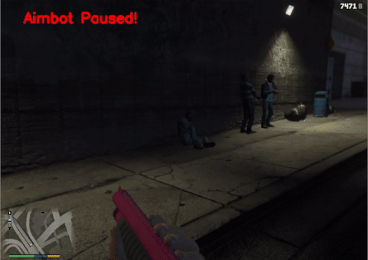

# GTA V Computer Vision Aimbot

Real-time object detection for GTA V using **YOLOv4-tiny** with OpenCV's DNN module. Detects pedestrians and provides aim assistance with configurable smoothing.

<p align="center">
  
</p>

## Features

- **Real-time detection** — YOLOv4-tiny running via OpenCV DNN (CUDA or CPU)
- **Fast capture** — DXGI Desktop Duplication via `dxcam` (~2–4 ms per frame)
- **Smooth aiming** — Configurable interpolation for natural mouse movement
- **In-game HUD overlay** — Boxes, FPS counter, detection count, crosshair and aim status drawn directly over the game (click-through, excluded from the screen capture; no separate preview window)
- **Auto-fire** — Fires only while the crosshair is on the target's head area (not while crossing the body)
- **Configurable** — All settings in `config.py` (thresholds, keys, model, etc.)
- **Head targeting** — Aims at the head: a detected `head` box inside the person (custom models), else estimated from the person box (COCO)
- **Target priority** — Automatically selects the person whose head is closest to the crosshair, then stays locked on them while the aim key is held (waiting through short detection gaps instead of jumping to someone else)
- **Never aims at you** — Your own character is found by scoring each person box on three signals: it stays fixed on screen while the camera turns, its colours match your saved profile, and (weakly) where it is on screen. You can also pick yourself by hand

## Requirements

- Python 3.10+ (needed by `dxcam`)
- Windows 10 (2004+) / 11 — needed to keep the overlay out of the screen capture
- GTA V or any other game (running in **windowed** or **borderless** mode)
- [YOLOv4-tiny weights](https://github.com/AlexeyAB/darknet/releases/download/darknet_yolo_v4_pre/yolov4-tiny.weights) — place in `models/`
- (Optional) NVIDIA GPU with CUDA support for acceleration

## Installation

```bash
git clone https://github.com/johneliades/gta_cv.git
cd gta_cv
pip install -r requirements.txt        # CPU (pip OpenCV)
# or, with your own CUDA-enabled OpenCV build already installed:
pip install -r requirements-gpu.txt    # does not install/overwrite OpenCV
```

Download the YOLOv4-tiny weights file into `models/`:
```bash
curl -L -o models/yolov4-tiny.weights https://github.com/AlexeyAB/darknet/releases/download/darknet_yolo_v4_pre/yolov4-tiny.weights
```

## Configuration

Edit `config.py` to customize behavior:

| Setting | Default | Description |
|---------|---------|-------------|
| `USE_CUDA` | `True` | Enable GPU acceleration (set `False` for CPU) |
| `BLOB_SIZE` | `(416, 416)` | Input resolution (higher = more accurate, slower) |
| `CONFIDENCE_THRESHOLD` | `0.5` | Minimum detection confidence |
| `NMS_THRESHOLD` | `0.3` | Non-maxima suppression overlap threshold |
| `AIM_SMOOTHING` | `0.6` | Mouse smoothing (0.0–1.0, lower = smoother) |
| `AIM_ACTIVATION_KEY` | `X` | Key to hold for aim assist |
| `AUTO_FIRE` | `True` | Auto-click when the crosshair is on the head area |
| `TRACK_MAX_MISSES` | `12` | Frames the target lock waits for a lost target to reappear |
| `TARGET_CLASS` | `person` | COCO class to target |
| `HEAD_Y_FRACTION` | `0.08` | Head estimate: fraction of the person box height below its top |
| `HEAD_SIZE_FRACTION` | `0.14` | Head estimate: square size as a fraction of the person box height (the auto-fire zone) |
| `SELF_EXCLUSION_ENABLED` | `True` | Find and ignore your own character |
| `SELF_WEIGHT_MOTION` / `_APPEARANCE` / `_POSITION` | `0.45` / `0.40` / `0.15` | Weights of the three self signals |
| `SELF_SCORE_THRESHOLD` | `0.5` | Minimum score for the best box to count as self |
| `SELF_SELECT_NEXT_KEY` / `_CONFIRM_KEY` | `F8` / `ENTER` | Pick yourself by hand |
| `SELF_PROFILE_FILE` | `self_profile.npy` | Where your colour profile is kept between runs |
| `RUN_AS_ADMIN` | `True` | Restart as administrator at launch (needed for games that run as administrator, e.g. GTA IV) |
| `QUIT_KEY` | `F10` | Key to hold to quit |

## Usage

1. Launch the game in **borderless fullscreen** or **windowed** mode (not exclusive fullscreen)
2. Run the script:
   ```bash
   python main.py
   ```
   Windows asks for administrator permission, and the script continues in a new window. Games that run as administrator (e.g. GTA IV) hide key presses from other programs, so without it no key works in them. Turn off with `RUN_AS_ADMIN = False`
3. Switch to the game window: the script follows whichever window is active (never the terminal it was started from)
4. Hold **X** to activate aim assist
5. Hold **F10** (or press Ctrl+C in the terminal) to quit

### Telling yourself apart

Each person box gets a self score (shown under it as `m= a= p= = total` while `SHOW_SELF_DEBUG` is on):

- **motion (m)** — In third person the camera follows you, so when you turn, the background slides across the screen while your character stays put. Boxes are followed from frame to frame, and one that stays fixed while the background moves scores high. The score is remembered while the camera is still.
- **appearance (a)** — How well the box's colours match your saved colour profile. The profile is learned on its own while the motion signal is sure, or saved when you pick yourself.
- **position (p)** — Whether the box lies in the usual self areas, bottom-left for third person or bottom-middle for first person (a weak hint; `SELF_THIRD_PERSON_*` / `SELF_FIRST_PERSON_*`).

Only the best box above `SELF_SCORE_THRESHOLD` is self. Until there is any evidence, the self areas decide on their own.

To pick yourself by hand: press **F8** to start, press it again until your character is highlighted, then press **Enter**. After the last person the highlight moves to a **Cancel** placeholder: press Enter on it to leave without picking. That box is treated as self while it stays tracked, and its colours become your profile. Aiming pauses while selecting. Do this again after changing outfit or character.

## Controls

| Key | Action |
|-----|--------|
| Hold `X` | Activate aimbot |
| `F8` | Start picking yourself / highlight the next person (then Cancel) |
| `Enter` | Pick the highlighted person as yourself (or leave, on Cancel) |
| Hold `F10` | Quit (`QUIT_KEY` in `config.py`) |

## Project Structure

```
├── main.py               # Entry point: main loop (capture → detect → aim → draw)
├── config.py             # All configurable settings
├── aimbot/
│   ├── capture.py        # Active-window targeting + screen capture (dxcam)
│   ├── detector.py       # YOLO model loading and detection (OpenCV DNN)
│   ├── targeting.py      # Self-area position rule and target selection
│   ├── self_id.py        # Finding your own character (motion, colours, position, manual pick)
│   ├── controls.py       # Key polling, mouse movement, fire button (SendInput)
│   ├── hud.py            # HUD drawing (boxes, FPS, status)
│   └── overlay.py        # Click-through overlay window over the game
├── models/
│   ├── coco.names        # COCO dataset class labels (80 classes)
│   ├── yolov4-tiny.cfg   # YOLOv4-tiny architecture (+ .weights, downloaded)
│   └── yolov4.cfg        # YOLOv4 full architecture (optional, + .weights)
├── docs/preview.gif
├── requirements.txt      # Dependencies incl. CPU OpenCV
├── requirements-gpu.txt  # Dependencies without OpenCV (custom CUDA build)
└── README.md
```

## Author

**Eliades John** — [GitHub](https://github.com/johneliades)
